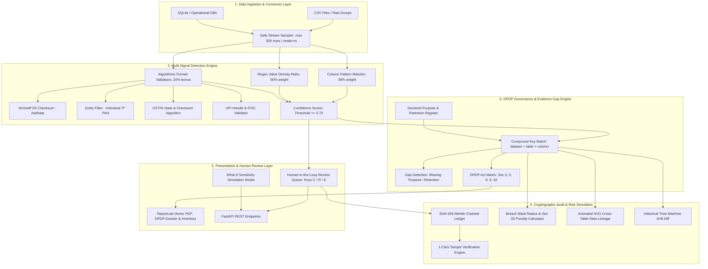

# PrivacyLens — Personal-Data Discovery & Privacy Evidence Inventory

**AIORI Hackathon 3 — Problem Statement PS-019 (Team TC057)**  
*An enterprise-grade, evidence-based privacy discovery scanner and regulatory compliance platform aligned with India's Digital Personal Data Protection (DPDP) Act 2023.*

---

### 🌐 Quick Links & Live Demos

* 🚀 **Live Cloud Deployment (Render):** [https://a3-ps019-tc057.onrender.com/](https://a3-ps019-tc057.onrender.com/)
* 📊 **Pitch Presentation Deck (PowerPoint PPTX):** [PrivacyLens_Presentation_TC057.pptx](PrivacyLens_Presentation_TC057.pptx)
* 📄 **Platform Guide & Innovation Matrix (PDF):** [PrivacyLens_Platform_Guide.pdf](PrivacyLens_Platform_Guide.pdf)
* 📖 **Features & Competitive Innovations (Markdown):** [FEATURES_AND_INNOVATIONS.md](FEATURES_AND_INNOVATIONS.md)
* 🎥 **Website Functionality Walkthrough (YouTube):** [https://youtu.be/MVfuXm52Rkw](https://youtu.be/MVfuXm52Rkw)
* 🎤 **Project Presentation Video (YouTube):** [https://youtu.be/BWVyN9AuqBE](https://youtu.be/BWVyN9AuqBE)
* 💻 **GitHub Repository:** [https://github.com/aiori-hackathon/A3-PS019-TC057](https://github.com/aiori-hackathon/A3-PS019-TC057)

---

[](https://aiori.in)
[](https://python.org)
[](https://fastapi.tiangolo.com)
[](https://www.meity.gov.in/writereaddata/files/Digital%20Personal%20Data%20Protection%20Act%202023.pdf)
[](#6-cryptographic-sha-256-audit-trail--tamper-verification)
[-success.svg)](backend/tests)
[](LICENSE)

---

## Table of Contents
1. [Executive Summary & Problem Statement](#1-executive-summary--problem-statement)
2. [Key Technical Capabilities & Differentiators](#2-key-technical-capabilities--differentiators)
3. [System Architecture & Data Flow](#3-system-architecture--data-flow)
4. [Supported Data Classes & Indian Identifiers](#4-supported-data-classes--indian-identifiers)
5. [Breach Blast Radius & Statutory Financial Liability](#5-breach-blast-radius--statutory-financial-liability)
6. [Cryptographic SHA-256 Audit Trail & Tamper Verification](#6-cryptographic-sha-256-audit-trail--tamper-verification)
7. [Animated SVG Data Lineage & Schema Drift](#7-animated-svg-data-lineage--schema-drift)
8. [REST API Reference](#8-rest-api-reference)
9. [Installation & Quickstart Guide](#9-installation--quickstart-guide)
10. [Docker Deployment](#10-docker-deployment)
11. [Guided Mentor & Judge Demonstration Script](#11-guided-mentor--judge-demonstration-script)
12. [Automated Test Suite (35 Tests)](#12-automated-test-suite-35-tests)
13. [Security & Privacy Safeguards](#13-security--privacy-safeguards)
14. [Submission Checklist](#14-submission-checklist)

---

## 1. Executive Summary & Problem Statement

Modern enterprise data architectures accumulate personally identifiable information (PII) across disparate CSV files, operational databases, data lakes, and third-party exports. Organizations face severe data governance risks:
* **Shadow PII & Sprawl:** Sensitive customer and employee records persist in unmonitored tables without formal cataloging.
* **Orphaned Personal Data:** Fields exist without declared statutory purposes or defined retention schedules.
* **Strict Statutory Penalties:** Under India's **Digital Personal Data Protection (DPDP) Act 2023**, failure to implement reasonable security safeguards or maintain auditable data inventories exposes organizations to penalties of up to **₹250 Crores (Section 33)**.

**PrivacyLens** addresses these challenges by delivering an evidence-based discovery scanner and regulatory evidence inventory:
1. **Multi-Signal Transparent Classification:** Combines column nomenclature patterns, regex value density ratios, and algorithmic format validators (Verhoeff dihedral checksums for Aadhaar, entity-aware PAN inspection, GSTIN checksums, IFSC verification, and UPI handle detection).
2. **Compound Metadata Linking:** Maps discovered columns `(dataset, table, column)` against corporate purpose and retention registers to instantly expose governance gaps.
3. **Statutory DPDP Act 2023 Governance Matrix:** Evaluates discovered data across Sections 5 (Notice), 6 (Consent), 8(7) (Erasure/Retention), 9 (Minor/Children Protection), and 33 (Financial Liability).
4. **Legally Defensible Cryptographic Audit Ledger:** An immutable, SHA-256 Merkle hash-chained ledger that records every human triage action, providing mathematical proof of non-tampering for Data Protection Board of India (DPBI) audits.
5. **Interactive Risk Simulation:** Features an animated SVG data lineage graph, a breach blast radius contagion calculator, and schema drift detection across historical scans.

> **Legal Disclaimer:** *PrivacyLens generates verifiable technical evidence and auditable governance dossiers for human-in-the-loop review by Data Protection Officers (DPOs). It provides technical decision support and does not constitute formal legal counsel.*

---

## 2. Key Technical Capabilities & Differentiators

| Capability | PrivacyLens Implementation (TC057) | Industry Standard / Competitor Comparison |
| :--- | :--- | :--- |
| **DPDP Act 2023 Statutory Alignment** | Native compliance engine mapping inventory to Sections 5, 6, 8, 9, and 33 with downloadable official PDF Dossiers. | Competitors often lack Indian statutory clause mapping or produce generic PII lists. |
| **Breach Blast Radius Simulator** | Models direct record compromise, downstream table contagion, quasi-identifier correlation (*Name + Aadhaar*), and computes **Section 33 statutory financial liability (Up to ₹250 Crores)**. | Generic tools only count static column numbers without cross-table cascading risk or statutory liability calculations. |
| **Animated SVG Data Lineage Graph** | Dynamic SVG network featuring animated pulsing data streams (`@keyframes flowDash`), table nodes, column badges, and interactive dependency isolation. | Static tables or heavy canvas dependencies that fail to convey cross-table identifier flow. |
| **Time Machine & Schema Drift** | Historical snapshot diff comparator tracking newly introduced personal columns and generating automated **Schema Drift Alerts**. | Single-run scanners with zero temporal diffing or change detection across deployments. |
| **Cryptographic SHA-256 Audit Trail** | Blockchain-style Merkle hash-chained ledger (`prev_hash` $\rightarrow$ `block_hash`) for every review decision with 1-click live verification. | Mutable database logs or flat CSV logs that can be tampered with after the fact. |
| **Algorithmic Indian Identifiers** | Full non-commutative **Verhoeff ($D_5$) dihedral** checksum for Aadhaar, **PAN entity taxonomy** (individual vs corporate suppression), **15-char GSTIN** checksum with state codes, **IFSC codes**, and **UPI handles**. | Naive 10/12-digit regex matching resulting in high false-positive rates on random numeric strings. |
| **Human-in-the-Loop Review Center** | Progressive disclosure triage queue with keyboard shortcuts (`C` Confirm, `R` Reject, `E` Evidence) and 1-click high-confidence batch approval. | Cluttered interfaces requiring repetitive manual mouse clicks for every record. |

---

## 3. System Architecture & Data Flow



---

## 4. Supported Data Classes & Indian Identifiers

PrivacyLens implements a multi-signal scoring model:
$$\text{Score} = (W_{\text{col}} \times S_{\text{col}}) + (W_{\text{val}} \times S_{\text{val}}) + (W_{\text{fmt}} \times S_{\text{fmt}}) - P_{\text{neg}}$$

A candidate is flagged when $\text{Score} \ge \text{Threshold}$ (default $0.70$).

| Personal Data Class | Column Signals | Value Regex & Structural Validation | Algorithmic Checksums & False-Positive Guardrails |
| :--- | :--- | :--- | :--- |
| **1. Person Name** | `full_name`, `cust_name`, `employee_name`, `first_name` | Alphabetic multi-word density $> 75\%$ | Penalizes non-personal columns (`company_name`, `file_name`, `product_id`). |
| **2. Email Address** | `email`, `email_address`, `work_email`, `contact_email` | RFC-5322 pattern `[a-zA-Z0-9._%+-]+@[a-zA-Z0-9.-]+\.[a-zA-Z]{2,}` | Verifies single `@`, domain dots, TLD length $\ge 2$, max length 254 chars. |
| **3. Phone Number** | `mobile`, `phone`, `contact_no`, `tel_no`, `whatsapp` | Indian cellular regex: `^(\+91[\-\s]?)?[6-9]\d{9}$` | Strips formatting; rejects repetitive dummy numbers (`1111111111`, `1234567890`). |
| **4. Government ID (Aadhaar, PAN, Passport)** | `aadhaar`, `uidai`, `pan`, `passport`, `voter_id` | 12-digit Aadhaar, 10-char PAN (`[A-Z]{5}[0-9]{4}[A-Z]{1}`) | **Aadhaar:** Validates official **Verhoeff dihedral ($D_5$) checksum**.<br>**PAN:** Inspects 4th character (`P` = Individual, suppresses corporate `C`, `F`, `G`). |
| **5. Date of Birth & Minor Protection** | `dob`, `date_of_birth`, `birth_date` | Standard date formats (`YYYY-MM-DD`, `DD/MM/YYYY`) | Plausibility range (0–125 years). Rejects future dates and ordinary created/updated timestamps. **Flags minors ($<18$) under DPDP Sec. 9**. |
| **6. Financial Data (UPI, GSTIN, Bank, IFSC)** | `upi_id`, `vpa`, `gstin`, `ifsc`, `bank_account` | UPI handles (`@okhdfcbank`, `@oksbi`, `@paytm`), 11-char IFSC (`^[A-Z]{4}0[A-Z0-9]{6}$`) | **GSTIN:** Validates 15-char structure with valid Indian state codes (01–38) & official checksum character. |

---

## 5. Breach Blast Radius & Statutory Financial Liability

Under **Section 33(1) of the DPDP Act 2023**, the Data Protection Board of India imposes statutory penalties based on the nature, gravity, and duration of personal data breaches:

$$\text{Max Penalty} = \text{₹250 Crores (Schedule Item 1: Failure to implement reasonable security safeguards)}$$

The **PrivacyLens Breach Blast Radius Simulator** provides real-time quantitative risk modeling:
1. **Direct Compromise:** Calculates the exact record count within the targeted table.
2. **Cascading Contagion Analysis:** Traverses cross-table foreign identifiers (e.g. `customer_id` present in `customers`, `orders`, and `payments`) to determine downstream exposure.
3. **Quasi-Identifier Combination Risks:**
   * $\text{Name} + \text{Government ID (Aadhaar/PAN)} \rightarrow$ **Critical Identity Theft & Synthetic ID Creation**.
   * $\text{Name} + \text{Phone Number} \rightarrow$ **Targeted Smishing & Social Engineering Vector**.
   * $\text{Name} + \text{Date of Birth} \rightarrow$ **Knowledge-Based Authentication Bypass**.
   * $\text{Email} + \text{Phone Number} \rightarrow$ **Account Takeover & SIM Swap Vulnerability**.
4. **Statutory Tier Assessment:** Automatically flags whether the breach triggers **Critical Exposure (Up to ₹250 Crores)**, **High Exposure (Up to ₹150 Crores)**, or **Moderate Exposure (Up to ₹50 Crores)** under Section 33.

---

## 6. Cryptographic SHA-256 Audit Trail & Tamper Verification

To satisfy legal evidentiary standards under the DPDP Act and the Indian Evidence Act, PrivacyLens implements a blockchain-style, cryptographically chained audit ledger:

```
[Genesis Block: prev_hash = "0"*64]
           │
           ▼
[Block 1: Hash = SHA-256(1 : timestamp : actor : action : target : payload : prev_hash)]
           │
           ▼
[Block 2: Hash = SHA-256(2 : timestamp : actor : action : target : payload : Block 1 Hash)]
           │
           ▼
[Block N: Hash = SHA-256(N : timestamp : actor : action : target : payload : Block N-1 Hash)]
```

### Tamper-Evident Verification:
* Every triage decision (`CONFIRMED`, `REJECTED`, or `BATCH_TRIAGE_APPROVAL`) appends a block.
* Clicking **"Verify Audit Integrity"** in the Review Queue triggers a full verification cycle via `POST /api/audit/verify`.
* If any record, actor, or payload is modified or deleted in the underlying database, the recomputed hash fails to match the chain, immediately raising a tamper alert with the exact compromised block index.

---

## 7. Animated SVG Data Lineage & Schema Drift

### Animated Data Lineage Graph:
* Renders a real-time SVG network diagram connecting datasets that share personal identifiers.
* Powered by custom SVG animations:
  ```css
  @keyframes flowDash {
    to { stroke-dashoffset: -24; }
  }
  .lineage-edge {
    stroke-dasharray: 6 4;
    animation: flowDash 1.2s linear infinite;
  }
  ```
* Dashed connector lines pulse continuously between database tables to illustrate live identifier flow. Clicking any table node isolates its dependencies and highlights shared risk vectors.

### Time Machine & Schema Drift Detection:
* Compares baseline discovery snapshots against subsequent runs via `GET /api/time-machine/diff`.
* Detects newly added personal fields and removed columns.
* Automatically raises **Schema Drift Alerts** when developers add uncataloged PII fields to production schemas, preventing compliance debt.

---

## 8. REST API Reference

The backend provides a fully documented RESTful API accessible via interactive Swagger docs at `http://localhost:8000/docs`:

| Method | Endpoint | Description |
| :--- | :--- | :--- |
| `GET` | `/api/health` | Service health status and timestamp. |
| `GET` | `/api/dashboard` | Aggregated metrics, class distributions, and confidence tiers. |
| `GET` | `/api/datasets` | List registered datasets with row and column counts. |
| `POST` | `/api/datasets/upload` | Upload CSV or SQLite database file with sanitization. |
| `GET` | `/api/datasets/{id}/preview`| Safe preview (top 5 rows) with read-only connection. |
| `POST` | `/api/scans` | Execute discovery scan on a specific dataset. |
| `POST` | `/api/scans/scan-all` | Execute 1-click discovery scan across all registered data sources. |
| `GET` | `/api/inventory` | Retrieve evidence inventory with confidence scores and masked samples. |
| `PATCH` | `/api/inventory/{id}/review`| Human triage action (confirm/reject) with cryptographic audit logging. |
| `POST` | `/api/inventory/batch-review`| High-confidence batch approval for fast triage. |
| `GET` | `/api/gaps` | Retrieve unmapped fields, missing purposes, and indefinite retention risks. |
| `GET` | `/api/dpdp/matrix` | DPDP Act 2023 compliance scoring and risk tier breakdown. |
| `GET` | `/api/lineage` | Node and edge network topology for data lineage graph. |
| `POST` | `/api/simulator/blast` | Breach blast radius calculation & Section 33 financial liability assessment. |
| `GET` | `/api/time-machine/diff` | Schema diff and automated drift alerts between historical scans. |
| `GET` | `/api/audit/chain` | Retrieve the SHA-256 cryptographically chained audit blocks. |
| `POST` | `/api/audit/verify` | Recompute and verify the cryptographic integrity of the audit chain. |
| `GET` | `/api/evaluation` | Benchmark accuracy metrics (Precision, Recall, F1) against labelled ground truth. |
| `GET` | `/api/reports/inventory.csv`| Export discovered inventory as structured CSV. |
| `GET` | `/api/reports/gaps.csv` | Export governance gap analysis as CSV. |
| `GET` | `/api/reports/inventory.pdf`| Generate ReportLab vector PDF evidence inventory. |
| `GET` | `/api/reports/dpdp.pdf` | Generate formal DPDP Act 2023 Statutory Audit Dossier (PDF). |

---

## 9. Installation & Quickstart Guide

### Prerequisites
* **Python 3.10+** (Tested on Python 3.10 through 3.14)
* **Node.js v18+** & **npm** (for building frontend assets, if desired)
* **Git**

### Step 1: Clone Repository
```bash
git clone https://github.com/aiori-hackathon/A3-PS019-TC057.git
cd A3-PS019-TC057
```

### Step 2: Set Up Virtual Environment & Dependencies
```bash
# Create virtual environment
python -m venv venv

# Activate virtual environment
# Windows:
.\venv\Scripts\activate
# macOS / Linux:
source venv/bin/activate

# Install Python requirements
pip install -r requirements.txt
```

### Step 3: Seed Synthetic Databases & Initialize Ledger
```bash
# Generate synthetic enterprise database
python sample_data/setup_sample_database.py

# Initialize database schema, seed registers, and genesis audit block
python -m backend.app.core.init_db
```

### Step 4: Launch Unified Server
```bash
python run.py
```

* 🖥️ **Web Application UI:** [http://localhost:8000/](http://localhost:8000/)
* 📚 **Interactive Swagger API Docs:** [http://localhost:8000/docs](http://localhost:8000/docs)
* 📖 **Redoc Specifications:** [http://localhost:8000/redoc](http://localhost:8000/redoc)

---

## 10. Docker Deployment

PrivacyLens includes a production-ready, lightweight Docker container:

### Build Container Image
```bash
docker build -t privacylens:latest .
```

### Run Container
```bash
docker run -d -p 8000:8000 --name privacylens privacylens:latest
```

Access the application in your browser at `http://localhost:8000/`.

---

## 11. Guided Mentor & Judge Demonstration Script

Follow this 5-minute walkthrough to evaluate all core capabilities:

1. **Dashboard Overview (`/`):**
   * Review high-level statistics: total datasets, candidate fields detected, and confidence distribution.
   * Note the **DPDP Act 2023 Statutory Governance** card and **SHA-256 Tamper-Evident Seal**.
2. **1-Click Global Discovery:**
   * Click **"Run Full Scan (All Datasets)"** in the top action bar.
   * Watch the scanner evaluate CSV files and multi-table SQLite databases simultaneously.
3. **Sensitivity Studio (4 Interactive Tabs):**
   * **Tab 1 (Sensitivity & Weights):** Adjust candidate threshold and rule weights; click **"Execute Live Benchmark Simulation"** to observe real-time Macro F1 recalculation.
   * **Tab 2 (Breach Blast Radius):** Move the **Leak Percentage Slider** to watch the animated radial gauge fill up. Observe downstream records at risk, quasi-identifier correlation risks, and **DPDP Section 33 ₹250 Crores penalty analysis**.
   * **Tab 3 (Data Lineage Graph):** View the animated SVG graph with flowing dashed connector lines. Click any node to isolate shared personal data flows.
   * **Tab 4 (Time Machine & Drift):** Review historical scan snapshots and observe automated **Schema Drift Alerts**.
4. **Human Review Queue & Cryptographic Audit Verification:**
   * Navigate to **Review Queue**.
   * Use keyboard shortcuts: press `C` to confirm or `R` to reject a candidate detection.
   * Scroll down to the **Cryptographic SHA-256 Audit Trail** card and click **"Verify Audit Integrity"**. Observe the live verification calculation confirming non-tampering.
5. **DPDP 2023 Matrix & PDF Dossier:**
   * Open the **DPDP 2023 Matrix** tab to inspect compliance scores across Sections 5, 6, 8(7), 9, and 16.
   * Click **"Download DPDP Dossier (PDF)"** in the header to download the formal, printable audit report.

---

## 12. Automated Test Suite (35 Tests)

PrivacyLens includes comprehensive automated test coverage covering scanner logic, connectors, metadata evaluation, and API routes.

Run the test suite with verbose output:
```bash
python -m pytest backend/tests -v
```

### Summary of Passing Test Suites:
```text
backend\tests\test_api.py ...........                                    [ 31%]
backend\tests\test_connectors.py .....                                   [ 45%]
backend\tests\test_metadata_and_eval.py .....                            [ 60%]
backend\tests\test_scanner.py ..............                             [100%]

======================== 35 passed, 1 warning in 3.68s ========================
```

* **API Endpoints (`test_api.py`):** Health check, dataset listings, dashboard metrics, scan workflows, human review patching, CSV/PDF report generation, 1-click scan-all, batch review, lineage graph, blast radius simulator, time-machine diff, and SHA-256 audit chain verification.
* **Connectors (`test_connectors.py`):** CSV stream reading, multi-table SQLite schema discovery, safe row sampling limits, and read-only URI connection enforcement.
* **Metadata & Evaluator (`test_metadata_and_eval.py`):** Compound identifier resolution, missing purpose/retention gap detection, scikit-learn standard evaluation metrics (TP, FP, FN, Precision, Recall, Macro F1).
* **Scanner & Validators (`test_scanner.py`):** Detection of all personal data classes, Aadhaar Verhoeff $D_5$ dihedral checksums, PAN entity classification, UPI handles, 15-char GSTIN checksum algorithms, IFSC codes, bank account formats, DOB age constraints, and negative controls suppression.

---

## 13. Security & Privacy Safeguards

* **100% Synthetic Data Guarantee:** All demonstration assets (`synthetic_customers.csv`, `synthetic_employees.csv`, `sample_enterprise.db`) contain entirely fictional data. No real personal data is bundled or transmitted.
* **In-Memory Masking:** Sensitive values are redacted (`XXXX-XXXX-9102`, `a***@example.com`) immediately in memory prior to database persistence and report generation.
* **Read-Only Database Connections:** Connectors strictly append `?mode=ro` / `immutable=1` URI parameters to prevent write access or accidental table modification.
* **Path Traversal Protection:** All file upload endpoints enforce `Path(filename).name` sanitization, preventing directory traversal attacks.
* **Safe YAML Compilation:** Rule configurations are loaded strictly using `yaml.safe_load` with pre-compilation syntax checks.
* **Cryptographic Tamper-Evidence:** SHA-256 hash chaining ensures that internal logs cannot be altered after the fact without detection.

---

## 14. Submission Checklist

- [x] **Working Web Application:** Full-stack architecture with React/TypeScript frontend and FastAPI backend.
- [x] **Live Public Cloud Deployment:** Deployed and operational on Render at [https://as-ps019-tc057.onrender.com/](https://as-ps019-tc057.onrender.com/).
- [x] **Video Demonstration:** Public walkthrough video on YouTube ([https://youtu.be/MVfuXm52Rkw](https://youtu.be/MVfuXm52Rkw)).
- [x] **Video Presentation:** Architecture and technical slide presentation on YouTube ([https://youtu.be/BWVyN9AuqBE](https://youtu.be/BWVyN9AuqBE)).
- [x] **Multi-Signal Detection Engine:** Column regex, value density ratios, and domain format validators.
- [x] **Extended Indian Identifiers:** Verhoeff Aadhaar checksums, individual PAN taxonomy, GSTIN state & checksum validation, IFSC codes, UPI handles.
- [x] **Compound Metadata Linking:** Purpose and retention mapping with gap analysis.
- [x] **DPDP Act 2023 Statutory Engine:** Clause-by-clause evaluation (Sections 5, 6, 8, 9, 33) and PDF dossier generation.
- [x] **Breach Blast Radius Simulator:** Downstream cross-table contagion analysis and Section 33 ₹250 Crores penalty modeling.
- [x] **Animated SVG Data Lineage:** Interactive network visualization with pulsing data flow streams.
- [x] **Time Machine & Schema Drift:** Historical snapshot diffing and automated drift alerts.
- [x] **Cryptographic SHA-256 Audit Trail:** Merkle-chained immutable audit ledger with 1-click verification.
- [x] **Human Review Workflow:** Progressive disclosure UI with keyboard shortcuts and batch triage.
- [x] **Standard Evaluation Module:** Scikit-learn benchmark metrics against ground truth.
- [x] **35 Passing Pytest Tests:** 100% automated test pass rate across all modules.
- [x] **Comprehensive Documentation:** Complete README, architecture specs, Dockerfile, and API documentation.

---

### Team TC057 — AIORI Hackathon 3 (Problem Statement PS-019)
* **Lead Full-Stack & Security Architect**
* **Privacy Engineer & Governance Specialist**
* **UI/UX Designer & Frontend Engineer**
